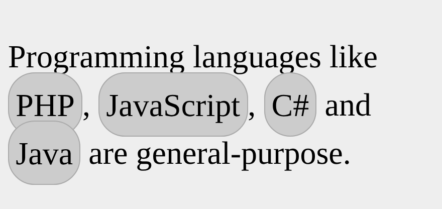

# Bài 2.1.6 – Định dạng hỗn hợp

Bài tập CSS trong sách *Bài tập Thiết kế Web*, mục **2.1.6. Định dạng hỗn hợp** (Hình 2.7).

## Kết quả



## Yêu cầu

- Tạo trang `languages.html`, dùng các thẻ `<span>…</span>` trong đoạn văn bản.
- Tạo file `langs.css` và nhúng vào trang bằng thẻ `<link rel="stylesheet" href="langs.css">`.
- Định dạng thẻ `body`: `background: #EEE; line-height: 1.5em; font-size: 24pt;`
- Định nghĩa class `.lang` cho tên ngôn ngữ: viền 1px màu `#AAA`, `border-radius: 20pt`, nền `#CCC`, `padding: 10pt 5pt`.

## Cấu trúc

```
css-dinh-dang-hon-hop/
├── languages.html   # đoạn văn có các thẻ <span class="lang">
├── langs.css        # file CSS ngoài
└── screenshot.png   # ảnh kết quả
```

## Kiến thức CSS sử dụng

- Nhúng file CSS ngoài bằng thẻ `<link>`
- Bộ chọn thẻ (`body`) và bộ chọn class (`.lang`)
- Thẻ inline `<span>` để định dạng riêng một phần của đoạn văn
- `border`, `border-radius`, `background`, `padding` trên phần tử inline
- Đơn vị `pt` và `em` (`line-height: 1.5em` nghĩa là chiều cao dòng bằng 1,5 lần cỡ chữ)

## Ghi chú

Đoạn CSS gợi ý trong sách có 2 lỗi gõ, đã được sửa lại:

| Trong sách | Đã sửa | Lý do |
|---|---|---|
| `border:1px #AAA;` | `border: 1px solid #AAA;` | thiếu kiểu viền thì trình duyệt hiểu là `none`, viền không hiện |
| `background:#CCC, padding: 10pt 5pt;` | `background: #CCC;` `padding: 10pt 5pt;` | các khai báo CSS phải ngăn cách bằng dấu `;` |

## Cách chạy

Tải repo về (**Code → Download ZIP**) rồi mở file `languages.html` bằng trình duyệt (giữ `langs.css` cùng thư mục).
